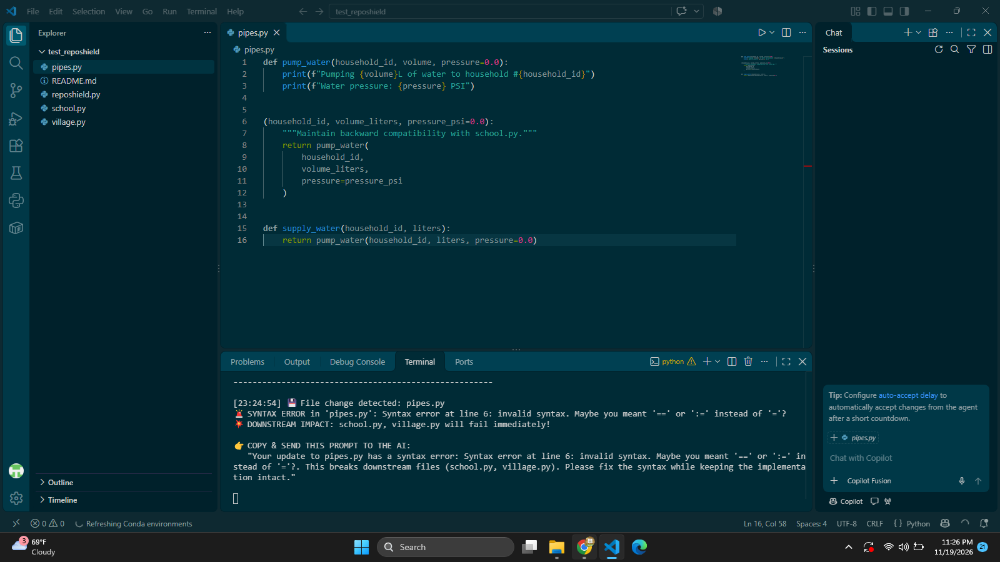

# 🛡️ RepoShield

**AI Code Safety & Cross-File Dependency Sentinel**  
*Catch silent regressions before AI-generated code breaks your production systems.*

---

## 🚨 The Problem

Modern AI models are incredible at writing code, but they suffer from **context isolation**. When you ask an AI to update or refactor a file, it only sees what you give it. 

It rewrites that single file cleanly, but it has no map of the codebase. A function rename or missing export in `utils.py` silently breaks `billing.py`, `dashboard.py`, and `api.py`. The code compiles in isolation, but crashes in production.

## 💡 The Solution

**RepoShield** is a zero-dependency static analysis engine built on Python's Abstract Syntax Tree (`ast`). It builds a live cross-file dependency graph of your project and acts as a safety barrier between AI code and your repository:

1. **Dependency Mapping**: Automatically indexes every function, class, and cross-file import.
2. **Contract Enforcement**: Detects when an edit removes or breaks a symbol needed by downstream files.
3. **Automated AI Remediation**: Generates precise, copy-pasteable prompts to force the AI model to fix its regressions while preserving backward compatibility.


---

## 🚀 Quickstart

RepoShield uses only Python's standard library—no heavy dependencies, no complex setup.

### 1. Scan your project blueprint
```bash
python reposhield.py scan .
```
Indexes every function definition and maps how files depend on each other.
```bash
python reposhield.py check .
```
Validates all import contracts. Exits with code 0 on success or code 1 with regression details for CI pipelines.
```bash
python reposhield.py watch .
```
Runs in the background while you paste AI-generated code into your editor. If an edit breaks downstream code, it immediately flags the impacted files and prints a ready-to-copy remediation prompt for your AI.

---

## 🧪 Try the Included Demo

This repo includes a minimal water distribution demo:
- `pipes.py`: Exposes water delivery functions.
- `village.py`: Consumes `supply_water()`.
- `school.py`: Consumes `deliver_water()`.

Run the watcher, then edit `pipes.py` to rename or remove a function to see RepoShield detect the breakage in real time.

---

## 🗺️ Roadmap

- [x] Python AST cross-file import analysis
- [x] Syntax error detection with downstream impact warnings
- [x] Automated AI remediation prompt generation
- [ ] Function signature & parameter mismatch detection
- [ ] GitHub Actions CI workflow integration
- [ ] Multi-language support (JavaScript/TypeScript)

---

## 👤 Author

Built by **Ray Koech** — 16-year-old student from Kenya.  
Passionate about software reliability, developer tooling, and AI safety.

## 📄 License

MIT

